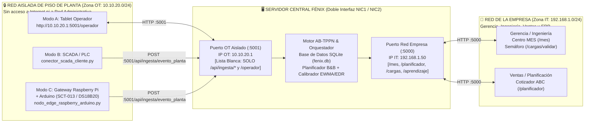

# Manual de Instalación y Despliegue de FÉNIX (MOM / MES Holónico para PyMEs)

**Versión:** 2.1 (Alineada con la Arquitectura Holónica PPR / AB-TPPN — *IEEE TII* y Segmentación OT/IT ISA/IEC 62443)  
**Público Objetivo:** Ingenieros de planta, integradores de automatización, administradores de redes/sistemas PyME e investigadores académicos.

---

## 1. Arquitectura de Red Segmentada OT / IT ("Primero el saber hacer, después la tecnología")

En una instalación industrial real, los equipos de borde de piso de planta (nodos Arduino + Raspberry Pi, PLCs/SCADA y tablets de operación) **nunca deben quedar expuestos directamente a la red administrativa ni a Internet**. Siguiendo las buenas prácticas de ciberseguridad industrial (**ISA/IEC 62443** adaptadas a PyMEs), Fénix se despliega como un **nodo puente de doble interfaz (*Dual-Homed MOM Server*)** que conecta dos zonas de red físicamente o lógicamente separadas:

1. **Zona Aislada de Piso de Planta (Red OT Segura — ej. `10.10.20.0/24`, Puerto `:5001`)**:
   - Red local cerrada (VLAN aislada o switch/AP WiFi industrial dedicado sin salida a Internet) donde se conectan todos los equipos de borde en sus tres modalidades:
     - **Modo A**: Tablets de operador en planta (`http://10.10.20.1:5001/operador`).
     - **Modo B**: Servidores SCADA o PLCs existentes (`http://10.10.20.1:5001/api/ingesta/evento_planta`).
     - **Modo C**: Gateways Raspberry Pi + Nodos Arduino/ESP32 (`http://10.10.20.1:5001/api/ingesta/evento_planta`).
   - **Política de Mínimo Privilegio en Puerto OT (`:5001`)**: El servidor Fénix aplica un filtro perimetral automático (`verificar_aislamiento_red_ot` en `web/app.py`) que **solo permite** en el puerto `:5001` el tráfico hacia la pasarela de ingesta (`/api/ingesta/*`) y la vista de operador (`/operador`), bloqueando con `HTTP 403 Forbidden` cualquier intento de acceder desde la planta a las interfaces financieras, de planificación o de modificación de modelos.

2. **Zona Empresarial / Administrativa (Red IT — ej. `192.168.1.0/24`, Puerto `:5000`)**:
   - Red de oficinas de la empresa donde se conectan los gerentes de operaciones, ingenieros de planta, planificadores y el sistema ERP/contable.
   - A través de la interfaz de red empresarial (`http://192.168.1.50:5000`), el servidor Fénix expone los módulos de gestión: **Centro de Control Ejecutivo MES (`/mes`)**, **Planificador y Cotizador ABC (`/planificador`)**, **Semáforo y Cargas (`/cargas/validar`)** y **Lazo de Aprendizaje (`/aprendizaje`)**.



---

## 2. Requisitos del Sistema y Topología de Red

### 2.1. Hardware Recomendado para el Servidor Central Fénix
- **Sistema Operativo**: Ubuntu Server/Desktop 22.04/24.04 LTS, Debian 12, Windows 10/11 Pro o Raspberry Pi 4/5 (64 bits).
- **Procesador y Memoria**: Dual-Core 2.0 GHz o superior, 4 GB de RAM mínimo, 10 GB de almacenamiento SSD/NVMe.
- **Interfaces de Red (Doble Tarjeta / Dual-NIC o VLAN Trunk)**:
  - **Interfaz 1 (`eth0` / Red Empresa IT)**: Conectada al switch de oficinas (ej. IP estática `192.168.1.50/24`).
  - **Interfaz 2 (`eth1` o adaptador USB-Ethernet / Red Aislada de Planta OT)**: Conectada al switch o punto de acceso industrial aislado de piso de planta (ej. IP estática `10.10.20.1/24`, sin puerta de enlace predeterminada para impedir enrutamiento hacia Internet).

### 2.2. Software Base y Dependencias Python (`fenix/pyproject.toml`)
- **Python 3.10, 3.11 o 3.12** y **Git**.
- Dependencias instaladas automáticamente desde `fenix/pyproject.toml`: `flask >= 3.0`, `sqlalchemy >= 2.0`, `pyyaml >= 6.0`, `openpyxl >= 3.1`, `lxml >= 5.0` y `pandas >= 2.0`.

---

## 3. Instalación Paso a Paso del Servidor Central

### Paso 1: Obtener el código fuente
```bash
git clone https://github.com/echacon/sgofenix.git
cd sgofenix
```

### Paso 2: Crear y activar el entorno virtual de Python

**En Windows (PowerShell):**
```powershell
python -m venv env
.\env\Scripts\Activate.ps1
```

**En Linux / Raspberry Pi OS:**
```bash
python3 -m venv env
source env/bin/activate
```

### Paso 3: Instalar el paquete Fénix y sus dependencias
```bash
pip install --upgrade pip
pip install -e "./fenix[dev]"
```

### Paso 4: Verificar la instalación con las suites formales (incluyendo aislamiento OT/IT)
```bash
# 1. Suite de verificación matemática del artículo IEEE TII (Ecuaciones 1 a 15)
python tests/simulador/verificar_paper_ieee_tii.py

# 2. Ejemplo integral End-to-End (Ruta de carga + Modos A/B/C + Seguridad de puerto OT :5001)
python tests/simulador/ejemplo_integral_modos_abc.py
```

---

## 4. Inicialización de la Base de Datos y Carga de Planta

### 4.1. Crear esquema y usuarios iniciales
```bash
python tools/carga/init_db.py
```

| Rol | Correo Electrónico | Contraseña Inicial | Zona de Red Recomendada | Permisos Principales |
| :--- | :--- | :--- | :--- | :--- |
| **Administrador / Ingeniero** | `admin@fenix.local` | `admin123` | **Red Empresa (IT `:5000`)** | Acceso completo a `/mes`, `/cargas/validar`, `/planificador`, `/aprendizaje` y autorización de invariantes. |
| **Operador de Planta** | `operador@fenix.local` | `operador123` | **Red Aislada Planta (OT `:5001`)** | Acceso exclusivo a `/operador` para disparo de eventos habilitados y control de calidad. |

---

## 5. Configuración de Puertos (Red Empresa vs. Red Aislada) y Puesta en Marcha

### 5.1. Variables de Entorno de Segmentación OT / IT
El servidor `web/app.py` levanta simultáneamente dos escuchadores HTTP independientes que puede vincular a las direcciones IP específicas de cada tarjeta de red:

| Variable de Entorno | Valor por Defecto | Descripción |
| :--- | :--- | :--- |
| `FENIX_IT_HOST` | `0.0.0.0` (En producción: `192.168.1.50`) | Dirección IP de la tarjeta de red conectada a la **Red de la Empresa (IT)**. |
| `FENIX_IT_PORT` | `5000` | Puerto expuesto hacia la **Red de la Empresa (IT)** (`/mes`, `/planificador`, `/cargas/validar`, `/aprendizaje`). |
| `FENIX_OT_HOST` | `0.0.0.0` (En producción: `10.10.20.1`) | Dirección IP de la tarjeta de red conectada a la **Red Aislada de Planta (OT)**. |
| `FENIX_OT_PORT` | `5001` | Puerto exclusivo hacia la **Red Aislada de Planta (OT)** (restringido por lista blanca a `/api/ingesta/*` y `/operador`). |
| `FENIX_HABILITAR_PUERTO_OT` | `1` | Activa (`1`) el escuchador dedicado en el puerto OT `:5001`. |

### 5.2. Ejemplo de arranque en producción con doble tarjeta de red (Dual-NIC)

**En Linux (Bash):**
```bash
export FENIX_IT_HOST="192.168.1.50"
export FENIX_IT_PORT="5000"
export FENIX_OT_HOST="10.10.20.1"
export FENIX_OT_PORT="5001"
python web/app.py
```

**En Windows (PowerShell):**
```powershell
$env:FENIX_IT_HOST = "192.168.1.50"
$env:FENIX_IT_PORT = "5000"
$env:FENIX_OT_HOST = "10.10.20.1"
$env:FENIX_OT_PORT = "5001"
python web/app.py
```

Al iniciar, verá en consola la confirmación de ambos canales:
```text
🚀 Iniciando Servidor Central FÉNIX con Segmentación de Red OT / IT
   🏢 Puerto hacia Red de Empresa (IT)        : http://192.168.1.50:5000  (/mes, /planificador, /cargas, /aprendizaje)
   🛡️  Puerto hacia Red Aislada de Planta (OT) : http://10.10.20.1:5001    (SOLO /api/ingesta/evento_planta y /operador)
```

---

## 6. Conexión de los Equipos de Borde en la Red Aislada de Planta (`10.10.20.0/24`)

Todos los dispositivos de piso de planta se configuran dentro del segmento aislado `10.10.20.0/24` apuntando al puerto OT del servidor Fénix (`http://10.10.20.1:5001`).

### 6.1. Versión A: Sin Tecnología Avanzada de Piso (Tablets de Operador en Red OT)
1. Conecte la tablet al punto de acceso WiFi aislado de planta (subred `10.10.20.0/24`, IP ej. `10.10.20.50`).
2. Abra el navegador en `http://10.10.20.1:5001/operador` e inicie sesión como `operador@fenix.local`.
3. Incluso si un usuario en la tablet intenta escribir manualmente `http://10.10.20.1:5001/planificador` o `/mes` en la barra de direcciones, el puerto OT `:5001` rechazará la petición con código `403 Forbidden`.

---

### 6.2. Versión B: Tecnología Media (SCADA / PLC en Red OT)
El nodo conector [`tools/edge_y_scada/conector_scada_cliente.py`](tools/edge_y_scada/conector_scada_cliente.py) apunta por defecto a `http://10.10.20.1:5001` e incluye la cabecera de zona `X-Fenix-Zone: OT`:

```python
from tools.edge_y_scada.conector_scada_cliente import ConectorSCADAFenix, MapeoTagSCADA

# Apunta al puerto exclusivo de la Red Aislada de Planta (OT :5001)
conector = ConectorSCADAFenix(url_base_fenix="http://10.10.20.1:5001")

conector.registrar_mapeo(MapeoTagSCADA(
    tag_disparo="PLC_ENV01.FIN_LOTE",
    recurso_fenix="Envasadora Automática SCADA 01",
    evento_fenix="Fin Envasado",
    red_fenix="red_ejecucion_mez_hom_env",
    tag_energia_kwh="PLC_ENV01.KWH_LOTE",
    tag_temperatura_c="PLC_ENV01.TEMP_SELLADO",
    tag_merma_kg="PLC_ENV01.MERMA_KG"
))
```

---

### 6.3. Versión C: Tecnología de Borde de Bajo Coste (Arduino/ESP32 + Raspberry Pi en Red OT)

#### A. Esquema de Hardware por Estación (< 80 USD)
| Componente Físico | Pin en Arduino UNO / Nano | Función en el Modelo Holónico AB-TPPN |
| :--- | :--- | :--- |
| **Pinza amperimétrica no invasiva SCT-013** | `A0` (Analógico) | Mide corriente eficaz $I_{\text{rms}}$ para integrar los $\text{kWh}$ del lote y calibrar $\text{EDR}(R)$ (Ec. 13 y Ec. 15). |
| **Sonda térmica impermeable DS18B20** | `D4` (Digital 1-Wire) | Mide temperatura continua $T$ ($^\circ\text{C}$) para verificar los invariantes físicos (`InvariantePaso`). |
| **Pulsador industrial Fin de Etapa** | `D2` (`INPUT_PULLUP`) | Dispara la señal de fin de operación (`boton_fin = 1`) hacia el Gateway Raspberry Pi. |
| **LED Indicador de Estado** | `D13` | Enciende cuando el motor supera el umbral de corriente en carga ($I > 2.5\text{ A}$). |

#### B. Ejecución del Gateway en la Raspberry Pi (IP OT ej. `10.10.20.21`)
La Raspberry Pi se conecta por cable USB a los Arduinos de las máquinas vecinas y por Ethernet/WiFi a la **Red Aislada de Planta (`10.10.20.0/24`)**, enviando los paquetes únicamente a `http://10.10.20.1:5001`:

```python
import serial
from tools.edge_y_scada.nodo_edge_raspberry_arduino import NodoEdgeRaspberryArduino

# Se comunica exclusivamente con la interfaz OT aislada del servidor Fénix (:5001)
gateway = NodoEdgeRaspberryArduino(url_base_fenix="http://10.10.20.1:5001")
gateway.registrar_estacion_arduino(
    nodo_id="ARD-MEZ-01",
    recurso_fenix="Mezclador Térmico 01 (Arduino Edge)",
    evento_fin_fenix="Fin Mezclado",
    red_fenix="red_ejecucion_mez_hom_env"
)

with serial.Serial("/dev/ttyUSB0", 115200, timeout=2) as ser:
    while True:
        linea = ser.readline().decode("utf-8", errors="ignore").strip()
        if linea.startswith("{"):
            gateway.procesar_trama_arduino(orden_id=ORDEN_ACTIVA_ID, trama_json=linea)
```

---

## 7. Solución de Problemas Frecuentes (Troubleshooting)

1. **Error `403 Forbidden` al intentar abrir `/mes` o `/planificador`**:
   - Verifique que está accediendo desde la **Red de la Empresa (IT)** por el puerto `:5000` (`http://192.168.1.50:5000/mes`). El puerto `:5001` pertenece exclusivamente a la **Red Aislada de Planta (OT)** y bloquea por diseño todas las rutas administrativas y de negocio.
2. **El Semáforo Pre-Producción (`/cargas/validar`) marca `ROJO` al validar mis YAMLs**:
   - Revise la tabla de diagnóstico en pantalla: indica qué etapa carece de un recurso con el servicio técnico requerido o qué par de recursos consecutivos $(R_a, R_b)$ no tiene tubería/enlace declarado en el grafo de conectividad física $\mathcal{K}$.
3. **El servidor responde `422 Unprocessable Entity` ante un evento de planta**:
   - El **Orquestador AB-TPPN bloqueó preventivamente el avance del lote** porque una medición física (ej. `temperatura_c`) violó los límites configurados en `InvariantePaso`.
