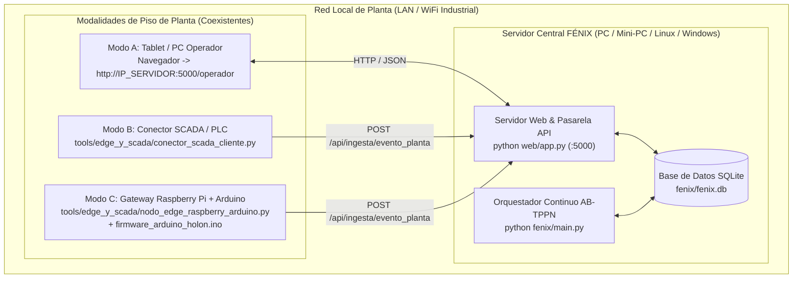

# Manual de Instalación y Despliegue de FÉNIX (MOM / MES Holónico para PyMEs)

**Versión:** 2.0 (Alineada con la Arquitectura Holónica PPR / AB-TPPN — *IEEE TII*)  
**Público Objetivo:** Ingenieros de planta, integradores de automatización, administradores de sistemas PyME e investigadores académicos.

---

## 1. Visión General del Despliegue ("Primero el saber hacer, después la tecnología")

Fénix está diseñado para adaptarse a la realidad presupuestaria y tecnológica de una Pequeña y Mediana Empresa (PyME) manufacturera sin exigir costosos servidores empresariales ni licencias propietarias. El sistema consta de:

1. **Núcleo Central Fénix (Servidor MOM / MES)**:
   - Puede ejecutarse en un PC industrial estándar (Windows 10/11 o Ubuntu Linux), una máquina virtual local o incluso un mini-PC / Raspberry Pi 4 o 5 dedicado en la oficina técnica de planta.
   - Utiliza **Python 3.10+**, **Flask** (interfaces web y API REST unificada) y **SQLite** (`fenix/fenix.db`) como base de datos transaccional ligera sin configuración de motor externo (migra de forma transparente a PostgreSQL si la empresa crece).
2. **Interfaces de Piso de Planta (Coexistencia de 3 Modalidades Tecnológicas)**:
   - **Versión A (Sin tecnología avanzada de piso — Human-in-the-Loop)**: Tablets o PCs económicos conectados a la red WiFi de la planta accediendo por navegador web a `/operador` y `/mes`.
   - **Versión B (Tecnología media — SCADA / PLC existente)**: Servicio conector en Python (`tools/edge_y_scada/conector_scada_cliente.py`) que lee tags de un SCADA o PLC existente y los inyecta en Fénix.
   - **Versión C (Tecnología de borde de bajo coste — Edge IIoT)**: Nodos basados en **Arduino Nano/UNO o ESP32** con pinza amperimétrica no invasiva **SCT-013**, sonda de temperatura **DS18B20** y pulsador industrial, concentrados por una **Raspberry Pi** (`tools/edge_y_scada/nodo_edge_raspberry_arduino.py`).



---

## 2. Requisitos del Sistema

### 2.1. Requisitos para el Servidor Central Fénix
- **Sistema Operativo**: Windows 10/11 (64 bits), Ubuntu 20.04/22.04/24.04 LTS, Debian 12 o Raspberry Pi OS (64 bits).
- **Hardware mínimo**: Procesador Dual-Core 2.0 GHz, 4 GB de RAM, 2 GB de espacio libre en disco, tarjeta de red Ethernet o WiFi.
- **Software base**:
  - **Python 3.10, 3.11 o 3.12** (verificar con `python --version`).
  - **Git** (opcional, para clonar y actualizar el repositorio).

### 2.2. Dependencias de Python (incluidas en `fenix/pyproject.toml`)
- `flask >= 3.0` (Servidor web, paneles MES/Operador/Planificador y API REST)
- `sqlalchemy >= 2.0` (ORM relacional para los modelos holónicos PPR y trazas AB-TPPN)
- `pyyaml >= 6.0` (Importación y validación de archivos YAML de planta)
- `openpyxl >= 3.1` y `pandas >= 2.0` (Importación de matrices de encadenamiento y análisis de datos)
- `lxml >= 5.0` (Parseo de redes de Petri en estándar PNML)

---

## 3. Instalación Paso a Paso del Servidor Central

### Paso 1: Obtener el código fuente
Abra una terminal (PowerShell en Windows o Bash en Linux) y clone el repositorio oficial:

```bash
git clone https://github.com/echacon/sgofenix.git
cd sgofenix
```

### Paso 2: Crear y activar el entorno virtual de Python

**En Windows (PowerShell):**
```powershell
python -m venv env
.\env\Scripts\Activate.ps1
```
*(Nota: Si PowerShell bloquea la ejecución de scripts en Windows, ejecute primero `Set-ExecutionPolicy -ExecutionPolicy RemoteSigned -Scope CurrentUser`).*

**En Linux / macOS / Raspberry Pi:**
```bash
python3 -m venv env
source env/bin/activate
```

### Paso 3: Instalar el paquete Fénix y sus dependencias
Con el entorno virtual activo, instale el núcleo `fenix` en modo editable junto con las herramientas de desarrollo y pruebas:

```bash
pip install --upgrade pip
pip install -e "./fenix[dev]"
```

### Paso 4: Verificar la instalación con las suites formales de prueba
Antes de poner en marcha el servidor, puede comprobar que el motor matemático AB-TPPN, el planificador Branch-and-Bound (Algoritmo 1), la calibración EWMA/EDR y la pasarela híbrida Modos A/B/C funcionan correctamente en su máquina:

```bash
# 1. Suite de verificación matemática del artículo IEEE TII (Ecuaciones 1 a 15)
python tests/simulador/verificar_paper_ieee_tii.py

# 2. Ejemplo integral End-to-End (Ruta de carga en 6 pasos + Modos A, B y C + MES)
python tests/simulador/ejemplo_integral_modos_abc.py
```
Ambos comandos se ejecutan sobre una base de datos en memoria (`sqlite:///:memory:`) sin alterar sus datos de producción y deben finalizar con el mensaje de éxito (`exit code 0`).

---

## 4. Inicialización de la Base de Datos y Carga de Planta

Fénix utiliza por defecto el archivo SQLite ubicado en `fenix/fenix.db`.

### 4.1. Inicialización de usuarios por defecto
Si desea inicializar o reiniciar el esquema base con los usuarios predeterminados:

```bash
python tools/carga/init_db.py
```

Las credenciales iniciales creadas son:
| Rol | Correo Electrónico | Contraseña Inicial | Permisos Principales |
| :--- | :--- | :--- | :--- |
| **Administrador / Ingeniero** | `admin@fenix.local` | `admin123` | Acceso total: Centro MES (`/mes`), Semáforo y Cargas (`/cargas/validar`), Planificador ABC (`/planificador`), Lazo EWMA (`/aprendizaje`) y Override de Invariantes. |
| **Operador de Planta** | `operador@fenix.local` | `operador123` | Acceso al Panel de Operación en Planta (`/operador`) y reporte de eventos/calidad. |

> [!CAUTION]
> En un entorno industrial real, cambie inmediatamente las contraseñas por defecto y defina una clave secreta robusta en `web/app.py` (`app.secret_key = os.environ.get("FENIX_SECRET_KEY", ...)`).

### 4.2. Carga de los modelos de la PyME (Ruta de Carga en 6 Pasos)
Una vez encendido el servidor web (Sección 5), el ingeniero de planta puede cargar y validar los archivos YAML de la empresa desde la interfaz gráfica **`/cargas/validar` (Semáforo & Cargas)** siguiendo los **6 pasos canónicos**:
1. **Unidades Funcionales** (Jerarquía física).
2. **Taxonomía Industrial** (Familias de producto y Tipos de operación).
3. **Patrones de Ruta, Redes de Petri (`.pnml`) y Reglas de Encadenamiento**.
4. **Holones de Recurso** (Equipos con tasas ABC $\kappa, \omega, \delta, \mu$, rendimiento $\gamma_R$, flag `medidor_energia` y Grafo de Conectividad Física $\mathcal{K}$).
5. **Holones de Producto, Rutas, Fórmulas (BOM) e Invariantes Físicos**.
6. **Validación Pre-Producción (Semáforo Verde/Amarillo)** antes de persistir en la base de datos viva.

*(Para el detalle de cada archivo YAML, consulte el Capítulo 4 del [`Manual_Usuario_MOM.md`](Manual_Usuario_MOM.md)).*

---

## 5. Puesta en Marcha del Sistema Fénix

En operación normal, Fénix ejecuta el servidor web (que incluye el Orquestador integrado para peticiones directas en `/api/ingesta/evento_planta` y `/mes`) y, opcionalmente, el proceso trabajador en segundo plano si se encolan eventos asíncronos mediante `cola_evento`.

### 5.1. Iniciar el Servidor Web y Centro de Control MES
Desde la raíz del proyecto (`sgofenix/`) con el entorno virtual activo:

```bash
python web/app.py
```

El servidor quedará escuchando en `http://0.0.0.0:5000` (accesible desde la propia máquina en `http://localhost:5000` y desde cualquier tablet o nodo de la red local en `http://<IP_DEL_SERVIDOR>:5000`).

### 5.2. Mapa de Interfaces Web Disponibles
Una vez autenticado en `http://localhost:5000/login`, tendrá acceso en la barra superior a los 5 módulos del sistema:

1. **Centro MES (`/mes`)**: Tablero ejecutivo con el estado de los 6 pasos de carga, mapa de Holones de Recurso (modalidad A/B/C, tasas ABC y salud energética $\text{EDR}$), evolución en vivo de órdenes y Token Coloreado $\tau=(o,m,c_{\text{acc}},t)$ sobre las redes $\mathcal{N}_E \parallel \mathcal{N}_S$, y consola interactiva de ingesta.
2. **Semáforo & Cargas (`/cargas/validar`)**: Diagnóstico de integridad referencial, conectividad física $\mathcal{K}$, invariantes y prueba en seco (*Dry-Run*) de paquetes YAML.
3. **Planificación ABC (`/planificador`)**: Ejecución del Algoritmo 1 (*Branch-and-Bound* con cota inferior $LB(\nu)$, plazo máximo $d$ y retropropagación de mermas $m_0 = q_n / \prod \gamma_k$) y reserva en las agendas $\Psi_R$.
4. **Operación Planta (`/operador`)**: Interfaz de piso para tablets (Modo A), disparo de transiciones habilitadas y registro de control de calidad.
5. **Lazo de Aprendizaje (`/aprendizaje`)**: Auditoría y ejecución del bucle lento EWMA/EDR (Ecuaciones 12 a 15).

---

## 6. Guía de Despliegue en Piso de Planta según Modalidad (A, B y C)

Fénix permite que **en una misma planta y dentro de una misma Orden de Producción** coexistan estaciones manuales (Modo A), estaciones conectadas a un SCADA existente (Modo B) y estaciones legadas instrumentadas con hardware abierto de bajo coste (Modo C). Todas reportan al mismo endpoint:
- **Endpoint Unificado**: `POST http://<IP_SERVIDOR>:5000/api/ingesta/evento_planta`

---

### 6.1. Despliegue Versión A: Sin Tecnología Avanzada de Piso (Operador en Tablet)
Ideal para iniciar la transformación digital en la PyME con inversión cero en hardware de instrumentación:
1. Conecte una tablet Android/iPad o PC de piso a la misma red WiFi que el Servidor Central Fénix.
2. Abra el navegador en `http://<IP_SERVIDOR>:5000/operador` e inicie sesión con la cuenta de operador (`operador@fenix.local`).
3. El operador visualiza únicamente los botones correspondientes a las transiciones de la serie `200` matemáticamente habilitadas por el marcado actual de la Red de Petri, evitando errores de secuencia.

---

### 6.2. Despliegue Versión B: Tecnología Media (Conector SCADA / PLC Existente)
Cuando la PyME ya dispone de un SCADA o PLC (OPC-UA, Modbus TCP o base de datos historiadora) en algunas máquinas:
1. Utilice la clase `ConectorSCADAFenix` incluida en [`tools/edge_y_scada/conector_scada_cliente.py`](tools/edge_y_scada/conector_scada_cliente.py).
2. Declare los mapeos entre los tags del PLC/SCADA y las transiciones de Fénix:

```python
from tools.edge_y_scada.conector_scada_cliente import ConectorSCADAFenix, MapeoTagSCADA

conector = ConectorSCADAFenix(url_base_fenix="http://192.168.1.100:5000")

conector.registrar_mapeo(MapeoTagSCADA(
    tag_disparo="PLC_ENV01.FIN_LOTE",
    recurso_fenix="Envasadora Automática SCADA 01",
    evento_fenix="Fin Envasado",
    red_fenix="red_ejecucion_mez_hom_env",
    tag_energia_kwh="PLC_ENV01.KWH_LOTE",
    tag_temperatura_c="PLC_ENV01.TEMP_SELLADO",
    tag_merma_kg="PLC_ENV01.MERMA_KG"
))

# Cuando el SCADA detecta flanco ascendente en PLC_ENV01.FIN_LOTE:
respuesta = conector.procesar_flanco_tag(
    orden_id=15,
    tag_disparo="PLC_ENV01.FIN_LOTE",
    lecturas_tags={
        "PLC_ENV01.KWH_LOTE": 6.50,
        "PLC_ENV01.TEMP_SELLADO": 42.0,
        "PLC_ENV01.MERMA_KG": 1.2
    }
)
```

---

### 6.3. Despliegue Versión C: Tecnología de Borde de Bajo Coste (Arduino/ESP32 + Raspberry Pi)
Para maquinaria electromecánica legada (reactores, mezcladores, molinos antiguos) sin PLC moderno, se instrumenta el **Holón Recurso** de manera externa y no invasiva por menos de 80 USD por estación:

#### A. Componentes de Hardware por Estación
- **Microcontrolador**: Arduino Nano / Arduino UNO / ESP32.
- **Sensor de Corriente No Invasivo**: Pinza amperimétrica de núcleo partido **SCT-013-030** (30 A / 1 V) abrazando una de las fases de alimentación del motor principal (o módulo medidor **PZEM-004T**).
- **Sensor de Temperatura de Proceso**: Sonda digital impermeable **DS18B20** (con resistencia pull-up de $4.7\text{ k}\Omega$ entre VCC y Datos).
- **Confirmación de Operación**: Pulsador industrial luminoso (NA) conectado entre el pin digital `D2` e `GND`.
- **Gateway de Borde**: Una **Raspberry Pi** (3B+, 4 o Zero 2 W) conectada por USB serie (`/dev/ttyUSB0`) a uno o varios Arduinos, o recibiendo sus tramas vía WiFi/MQTT.

#### B. Esquema de Conexión en el Arduino (`tools/edge_y_scada/firmware_arduino_holon.ino`)
| Componente Físico | Pin en Arduino UNO / Nano | Función en el Modelo Holónico AB-TPPN |
| :--- | :--- | :--- |
| **Pinza SCT-013** (con circuito de polarización a $2.5\text{ V}$) | `A0` (Analógico) | Mide corriente eficaz $I_{\text{rms}}$ para integrar los $\text{kWh}$ del lote y calibrar $\text{EDR}(R)$ (Ec. 13 y Ec. 15). |
| **Sonda térmica DS18B20** | `D4` (Digital 1-Wire) | Mide temperatura continua $T$ ($^\circ\text{C}$) para verificar los invariantes físicos (`InvariantePaso`) antes de permitir el disparo de la transición. |
| **Pulsador industrial Fin de Etapa** | `D2` (`INPUT_PULLUP`) | Dispara la señal de fin de operación (`boton_fin = 1`) hacia el Gateway Raspberry Pi. |
| **LED Indicador de Estado** | `D13` | Enciende cuando el motor supera el umbral de corriente en carga ($I > 2.5\text{ A}$). |

#### C. Carga del Firmware y Ejecución del Gateway en Raspberry Pi
1. Abra [`tools/edge_y_scada/firmware_arduino_holon.ino`](tools/edge_y_scada/firmware_arduino_holon.ino) en el **Arduino IDE**, ajuste la constante `NODO_ID` (ej. `"ARD-MEZ-01"`) y el factor de calibración de su pinza `CALIBRACION_SCT`, y cargue el programa en la placa.
2. En la **Raspberry Pi**, instale `pyserial` (`pip install pyserial`) y utilice [`tools/edge_y_scada/nodo_edge_raspberry_arduino.py`](tools/edge_y_scada/nodo_edge_raspberry_arduino.py) para leer el puerto serie e inyectar automáticamente los eventos y la energía integrada hacia el servidor Fénix:

```python
import serial
from tools.edge_y_scada.nodo_edge_raspberry_arduino import NodoEdgeRaspberryArduino

gateway = NodoEdgeRaspberryArduino(url_base_fenix="http://192.168.1.100:5000")
gateway.registrar_estacion_arduino(
    nodo_id="ARD-MEZ-01",
    recurso_fenix="Mezclador Térmico 01 (Arduino Edge)",
    evento_fin_fenix="Fin Mezclado",
    red_fenix="red_ejecucion_mez_hom_env"
)

# Lectura continua desde el puerto serie USB de la Raspberry Pi (115200 bps)
with serial.Serial("/dev/ttyUSB0", 115200, timeout=2) as ser:
    while True:
        linea = ser.readline().decode("utf-8", errors="ignore").strip()
        if linea.startswith("{"):
            # Integra kWh en cada segundo y dispara el evento a Fénix cuando boton_fin == 1
            gateway.procesar_trama_arduino(orden_id=ORDEN_ACTIVA_ID, trama_json=linea)
```

---

## 7. Solución de Problemas Frecuentes (Troubleshooting)

1. **El Semáforo Pre-Producción (`/cargas/validar`) marca `ROJO` al validar mis YAMLs**:
   - Revise la tabla de diagnóstico en pantalla: indica exactamente qué etapa carece de un recurso con el servicio técnico requerido o qué par de recursos consecutivos $(R_a, R_b)$ no tiene tubería/enlace declarado en el grafo de conectividad física $\mathcal{K}$.
2. **Al enviar un evento desde Arduino/SCADA (`/api/ingesta/evento_planta`), el servidor responde `422 Unprocessable Entity`**:
   - No es un fallo de red: significa que el **Orquestador AB-TPPN bloqueó preventivamente el avance del lote** porque una medición física (por ejemplo, `temperatura_c`) violó los límites de seguridad configurados en `InvariantePaso`. Un supervisor puede autorizar el avance excepcional marcando `forzar: true`.
3. **El servidor devuelve `409 Conflict` al intentar disparar una transición**:
   - La transición solicitada no está habilitada en el marcado actual de la Red de Petri. Consulte el **Centro de Control MES (`/mes`)** para ver en qué lugar activo se encuentra el Token Coloreado de la orden.
