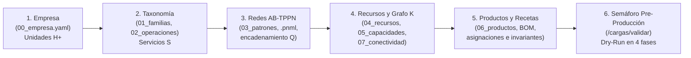
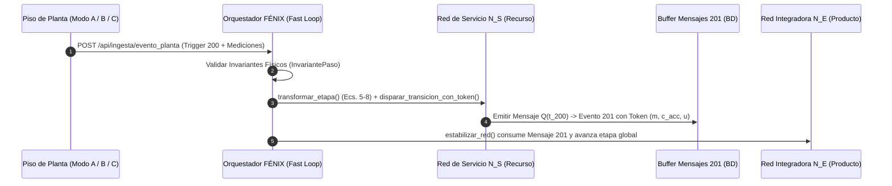

# Manual Técnico de Arquitectura, Integración y Modelado Matemático MOM (FÉNIX)

---

## 0. Filosofía y Génesis del Sistema FÉNIX

El sistema **FÉNIX** (*Manufacturing Operations Management - MOM*) representa un cambio de paradigma en la integración y control de operaciones industriales para Pequeñas y Medianas Empresas (PyMEs). Su principio rector es:

> **«Primero la captura e integración del saber hacer (procesos de negocio y procesos de planta); después, la incorporación progresiva de la tecnología.»**

Nace de la evolución desde los modelos rígidos de control jerárquico vertical (**ISA-95**) hacia un **marco holónico Producto–Proceso–Recurso (PPR)** acoplado a **Redes de Petri Temporizadas Basadas en Actividades (AB-TPPN)**.

```
          ENFOQUE CLÁSICO (ISA-95)                      ENFOQUE HOLÓNICO PPR (FÉNIX)
                 
               [ Nivel 4: ERP ]                                    ┌──────────────────────┐
                      │                                    ┌──────>│  Token Coloreado k   │<──────┐
               [ Nivel 3: MES ]                            │       │ (Orden / Costeo ABC) │       │
                      │                                    ▼       └──────────────────────┘       ▼
              [ Nivel 2: SCADA ]                   ┌──────────────┐     Mensajes 201      ┌──────────────┐
                      │                            │ Holón Recurso│<─────────────────────>│Holón Producto│
              [ Nivel 1: PLCs ]                    │  (Red N_S)   │   Conectividad K      │  (Red N_E)   │
                                                   └──────────────┘                       └──────────────┘
```

### 0.1. Formalización Ontológica PPR (Ecuaciones 1–3)

1. **Holón Genérico (Ecuación 1):**
   $$H = \langle \mathit{id}, \mathit{type}, A, \mathcal{C}, H^+ \rangle$$
   donde $\mathit{id}$ es el identificador único, $\mathit{type} \in \{\text{Product}, \text{Resource}\}$, $A$ el conjunto de atributos de estado, $\mathcal{C} \subseteq 2^H$ el conjunto de holones hijos agregados (p. ej., equipos dentro de una `UnidadFuncional`) y $H^+$ la referencia al holón contenedor padre.

2. **Holón Producto — Lado de la Demanda (Ecuación 2):**
   $$\mathit{PH} = \langle \mathit{id}, M, C_{\mathrm{raw\_in}}, \mathcal{E}, \mathcal{N}_E, d \rangle$$
   * $M$: Lista de materiales (*Bill of Materials*, `Formula` e `InsumoFormula`).
   * $C_{\mathrm{raw\_in}}$: Vector de costos unitarios de materias primas.
   * $\mathcal{E} = \langle E_1, E_2, \dots, E_n \rangle$: Secuencia ordenada de etapas tecnológicas requeridas (`EtapaRuta`), sujeta a composición selectiva $\mathcal{E}_P \subseteq \mathcal{E}$.
   * $\mathcal{N}_E$: Red de Petri de Integración que coordina el flujo extremo a extremo del producto.
   * $d$: Horizonte temporal máximo de entrega (*deadline*).

3. **Holón Recurso — Lado de la Oferta (Ecuación 3):**
   $$\mathit{RH} = \langle \mathit{id}, \mathcal{S}, \mathcal{P}, \Gamma, \kappa, \omega, \delta, \mu, \Omega, \Psi \rangle$$
   * $\mathcal{S}$: Conjunto de servicios técnicos ofrecidos por la estación (`ServicioTecnicoOfrecido`).
   * $\mathcal{P}$: Conjunto de Redes de Petri de Servicio ($\mathcal{N}_S$) que modelan la secuencia operativa interna del equipo.
   * $\Gamma: P_{\mathrm{proc}} \to (0, 1]$: Función de rendimiento másico físico $\gamma(p, R)$ (`rendimiento_nominal` / `rendimiento_gamma`), separada estrictamente de la eficiencia temporal (`eficiencia_real`).
   * $\kappa, \omega, \delta, \mu$: Tasas horarias de costeo basado en actividades (**ABC**) para energía eléctrica ($\kappa$), mano de obra directa ($\omega$), depreciación de maquinaria ($\delta$) y costos indirectos de gestión/overhead de planta ($\mu$, `costo_overhead_hora`).
   * $\Omega$: Calendario de disponibilidad operativa nominal (`disponible`).
   * $\Psi$: Agenda dinámica de intervalos de tiempo comprometidos por órdenes activas (`Recurso.agenda`).
   * **Topología de Conectividad Física ($\mathcal{K} \subseteq \mathit{RH} \times \mathit{RH}$):** Grafo dirigido (`ConexionFisica`) donde $(R_a, R_b) \in \mathcal{K} \iff$ existe una tubería, manguera, bomba o multiplexor disponible para transferir material entre $R_a$ y $R_b$.

---

## 1. Fundamento Matemático: Redes de Petri AB-TPPN (Definición 1 y Ecuaciones 4–8)

### 1.1. Definición 1: La 7-Tupla AB-TPPN
Tanto la Red de Integración ($\mathcal{N}_E$) como las Redes de Servicio ($\mathcal{N}_S$) se definen formalmente mediante la 7-tupla implementada en [`fenix/utils/motor_abtppn.py`](file:///C:/Users/echac/Documents/gemini/sgofenix/fenix/utils/motor_abtppn.py):
$$\mathcal{N} = \langle P, T, F, \tau, \Phi, Q, M_0 \rangle$$

* $P = P_{\mathrm{proc}} \cup P_{\mathrm{ctrl}} \cup P_{\mathrm{res}}$: Conjunto finito de lugares particionado en etapas de procesamiento activo ($P_{\mathrm{proc}}$), estados de control/sincronización ($P_{\mathrm{ctrl}}$) y disponibilidad de recursos ($P_{\mathrm{res}}$).
* $T = T_{\mathrm{auto}} \cup T_{200} \cup T_{201} \cup T_{202}$: Conjunto finito de transiciones particionado por semántica de disparo (*trigger*):
  * $T_{\mathrm{auto}}$ (`trigger = None`): Transiciones automáticas inmediatas al cumplirse precondiciones.
  * $T_{200}$ (`trigger = '200'`): Transiciones sincronizadas por eventos externos del piso de planta (Operador en Modo A, SCADA en Modo B, o Nodo Edge en Modo C).
  * $T_{201}$ (`trigger = '201'`): Transiciones de sincronización inter-red por paso de mensajes entre $\mathcal{N}_E$ y $\mathcal{N}_S$.
  * $T_{202}$ (`trigger = '202'`): Transiciones temporizadas (*watchdog* / *timeout*).
* $F \subseteq (P \times T) \cup (T \times P)$: Relación de flujo dirigida.
* $\tau: P_{\mathrm{proc}} \to \mathbb{R}^+$: Tiempo de residencia esperado en cada lugar de proceso.
* $\Phi: P_{\mathrm{proc}} \to \mathbb{R}^+$: Tasa compuesta de acumulación de costo ABC en cada lugar activo.
* $Q: T_{201} \rightharpoonup T_{201}$: Función parcial de acoplamiento de mensajes inter-red (`ConfiguracionEncadenamiento`).
* $M_0: P \to \mathbb{N}_0$: Marcado inicial de la red.

### 1.2. El Token Coloreado y las Reglas de Evolución (Ecuaciones 4–8)
Cada orden de producción circula como un **Token Coloreado** estructurado (`TokenColoreado`, **Ecuación 4**):
$$k = \langle \mathit{lot\_id}, m, c_{\mathrm{acc}}, \mathit{raw\_add}, t_{\mathrm{arr}}, V_{\mathrm{target}} \rangle$$

Al transitar por un lugar de proceso $p \in P_{\mathrm{proc}}$ ejecutado por el recurso $R$, el método `TokenColoreado.transformar_etapa()` aplica:

1. **Balance de Masa con Rendimiento (Ecuación 5):**
   $$m_{\mathrm{exit}} = (m_{\mathrm{enter}} + \Delta m_{\mathrm{raw}}(p)) \cdot \gamma(p, R)$$
2. **Costo de Procesamiento ABC en la Etapa (Ecuación 6):**
   $$c_{\mathrm{proc}}(p, R) = \left(\kappa_R^{\mathrm{eff}} + \omega_R + \delta_R + \mu_R\right) \cdot \tau(p, R)$$
3. **Costo Total Acumulado del Lote (Ecuación 7):**
   $$c_{\mathrm{acc, exit}} = c_{\mathrm{acc, enter}} + c_{\mathrm{raw}}(p) + c_{\mathrm{proc}}(p, R)$$
4. **Absorción de Merma en el Costo Unitario Saliente (Ecuación 8):**
   $$u_{\mathrm{exit}} = \frac{c_{\mathrm{acc, exit}}}{m_{\mathrm{exit}}} = \frac{c_{\mathrm{acc, enter}} + c_{\mathrm{raw}}(p) + c_{\mathrm{proc}}(p, R)}{(m_{\mathrm{enter}} + \Delta m_{\mathrm{raw}}(p)) \cdot \gamma(p, R)}$$

La viabilidad económica del lote se verifica en todo instante mediante el invariante $c_{\mathrm{acc}} \le V_{\mathrm{target}}$.

---

## 2. Ruta de Carga y las 3 Modalidades de Integración en Planta (Versiones A, B y C)

### 2.1. Ruta de Carga Canónica en 6 Pasos
Para desplegar una nueva planta o línea de producción en FÉNIX, la configuración sigue estrictamente el orden ontológico de dependencias:



### 2.2. Las 3 Versiones de Captura en Piso de Planta (Coexistentes)
El motor AB-TPPN recibe los eventos de planta ($T_{200}$) y las lecturas de proceso a través del protocolo unificado `POST /api/ingesta/evento_planta`, permitiendo que tres niveles tecnológicos operen simultáneamente en la misma orden de producción:

| Versión | Nivel Tecnológico | Mecanismo de Captura de Eventos (`Trigger 200`) y Telemetría | Costo de Hardware |
| :--- | :--- | :--- | :---: |
| **Versión A** | **Sin Tecnología Avanzada de Piso (*Human-in-the-Loop*)** | El operador utiliza una tablet o PC en planta (`/operador` o `/mes`) para señalar inicio/fin de actividad e ingresar lecturas manuales (peso, temperatura, pH/viscosidad). | **\$0** (Red Wi-Fi local y navegador web) |
| **Versión B** | **Tecnología Media (*Integración con SCADA / PLC existente*)** | Un servicio conector (`tools/edge_y_scada/conector_scada_cliente.py`) lee los *tags* de estado y totalizadores de energía/masa del SCADA o servidor OPC-UA/Modbus existente y los inyecta en FÉNIX. | **\$0 adicional** (Aprovecha infraestructura OT previa) |
| **Versión C** | **Tecnología de Borde de Bajo Coste (*Low-Cost Edge IIoT*)** | Nodos abiertos basados en **Arduino / ESP32** (adquisición de sensores: pinza amperimétrica no invasiva SCT-013 o medidor PZEM-004T para el consumo eléctrico del holón, termocupla DS18B20/PT100 y pulsador industrial) conectados a una **Raspberry Pi** (`tools/edge_y_scada/nodo_edge_raspberry_arduino.py`) que publica el JSON hacia FÉNIX. | **\$50 – \$120** por estación / holón |

---

## 3. Protocolos de Orquestación y Sincronización Inter-Redes

### 3.1. Acoplamiento de Mensajes $Q: T_{201} \rightharpoonup T_{201}$
Cuando la Red de Integración ($\mathcal{N}_E$) delega una etapa a la Red de Servicio ($\mathcal{N}_S$) de un equipo o viceversa, el `Orquestador` ([`fenix/servicios/orquestador.py`](file:///C:/Users/echac/Documents/gemini/sgofenix/fenix/servicios/orquestador.py)) gestiona un buffer transaccional persistente (`MensajePendiente`):



---

## 4. Planificación Holónica: Proposición 1 y Algoritmo 1 (Sección V)

El servicio `PlanificadorProduccion` ([`fenix/servicios/planificador.py`](file:///C:/Users/echac/Documents/gemini/sgofenix/fenix/servicios/planificador.py)) resuelve el problema conjunto de selección de ruta, asignación de recursos y programación temporal.

### 4.1. Retropropagación de Mermas y Proposición 1 (Ecuación 9)
Para entregar una cantidad neta final $q_n$ al cliente tras $n$ etapas con factores de rendimiento $\gamma(E_i, R_i) \in (0, 1]$, la masa inicial requerida a la entrada de la etapa 1 es (**Ecuación 9**):
$$m_0 = \frac{q_n}{\prod_{i=1}^n \gamma(E_i, R_i)}$$

> **Proposición 1 (No-Monotonicidad y Dependencia de Camino de los Estados de Costo):**
> Dado que una merma en una etapa aguas abajo $k$ obliga a incrementar la masa inicial $m_0$, esto incrementa simultáneamente el costo de materia prima inicial $C_{\mathrm{raw}}(m_0)$ y las masas en tránsito $m_{j-1}$ en todas las etapas previas $j \le k$, alargando los tiempos de operación dependientes de masa $\tau(E_j, R_j, m_{j-1})$. Por tanto, una selección miope etapa por etapa es subóptima; se requiere evaluar la trayectoria acoplada completa (**Ecuación 10**):
> $$\min_{\pi \in \Pi_{\mathrm{feas}}} J(\pi) = C_{\mathrm{raw}}(m_0) + \sum_{i=1}^n \left(c_{\mathrm{raw\_add}}(E_i) + c_{\mathrm{proc}}(E_i, R_i) + c_{\mathrm{trans}}(R_{i-1}, R_i)\right)$$

### 4.2. Algoritmo 1: Poda de Factibilidad en Dos Etapas y Branch-and-Bound
1. **Fase 0 — Composición Selectiva ($\mathcal{E}_P \subseteq \mathcal{E}$):** Filtra las rutas `HolonRuta` por rango de lote y prioridad, y omite etapas opcionales (como molienda `MOL`) si la fórmula del producto no declara insumos en ellas.
2. **Fase 1a — Poda Topológica ($\mathcal{K}$):** Verifica mediante búsqueda en anchura (`_buscar_camino_trasvase`) que exista camino físico activo entre $R_{k-1}$ y $R_k$.
3. **Fase 1b — Poda Temporal sobre la Agenda Dinámica ($\Psi_R$):** Calcula el tiempo de llegada más temprano $\mathrm{EAT}_k$, busca el primer hueco libre en `Recurso.agenda` para obtener el inicio más temprano $\mathrm{EST}_k \ge \mathrm{EAT}_k$ y el fin $\mathrm{EFT}_k = \mathrm{EST}_k + \tau(E_k, R_k)$. Si $\mathrm{EFT}_k + \sum_{j=k+1}^n \tau_{\min}(E_j) > d$, la rama se poda por fecha límite.
4. **Fase 2 — Búsqueda Branch-and-Bound con Cota Inferior Admisible $LB(\nu)$ (Ecuación 11):**
   En cada nodo parcial $\nu$ en la etapa $k$, se evalúa la cota inferior admisible:
   $$LB(\nu) = c_{\mathrm{acc}}(\nu) + \sum_{j=k+1}^n \left(c_{\mathrm{raw}}^{\min}(E_j) + \min_{R \in \mathcal{R}_{\mathrm{cand}}(E_j)} \Phi(E_j, R) \cdot \tau_{\min}(E_j, R)\right)$$
   Si $LB(\nu) > \min(J^*, V_{\mathrm{target}})$, el subárbol se poda sin necesidad de expandirlo.

---

## 5. Bucle Cerrado de Doble Escala Temporal y Resiliencia (Sección VI, Ecuaciones 12–15)

### 5.1. Bucle Rápido (*Fast Loop*) vs. Bucle Lento (*Slow Loop*)
1. **Bucle Rápido (En línea, por evento $T_{200}$):** Verifica invariantes de proceso (`InvariantePaso`) y actualiza el costo acumulado y unitario del `TokenColoreado` con la duración real medida.
2. **Bucle Lento (Por lote completado, `ejecutar_aprendizaje_orden`):** Cuando una orden finaliza con telemetría íntegra y se alcanza el umbral mínimo de muestras $N_{\min}$ (`n_min`), FÉNIX recalibra los parámetros mediante suavizado exponencial **EWMA** ($\alpha \in (0, 1)$, por defecto $\alpha = 0.2$):
   * **Ecuación (12) — Calibración de Eficiencia Temporal:**
     $$\eta_{\mathrm{temp}, k+1}(p, R) = \alpha \cdot \left(\frac{\tau_{\mathrm{nom}}(p, R)}{\tau_{\mathrm{meas}, k}(p, R)}\right) + (1 - \alpha) \cdot \eta_{\mathrm{temp}, k}(p, R)$$
   * **Ecuación (13) — Índice de Desviación Energética ($\mathrm{EDR}$):**
     $$\mathrm{EDR}_{k+1}(R) = \alpha \cdot \left(\frac{E_{\mathrm{meas}, k}(R)}{P_{\mathrm{nom}}(R) \cdot \tau_{\mathrm{meas}, k}(p, R)}\right) + (1 - \alpha) \cdot \mathrm{EDR}_k(R)$$
   * **Ecuación (14) — Calibración del Rendimiento Másico ($\gamma$):**
     $$\gamma_{k+1}(p, R) = \alpha \cdot \left(\frac{m_{\mathrm{exit}, k}}{m_{\mathrm{enter}, k}}\right) + (1 - \alpha) \cdot \gamma_k(p, R)$$
   * **Ecuación (15) — Tasa Energética Efectiva:**
     $$\kappa_R^{\mathrm{eff}} = \mathrm{EDR}(R) \cdot \kappa(R)$$
     *(El factor $\mathrm{EDR}(R)$ escala únicamente el costo horario energético $\kappa(R)$ cuando `medidor_energia = True`, sin distorsionar la depreciación contable $\delta_R$).*

### 5.2. Resiliencia ante Pérdida de Eventos (*Tracking Error*)
Si un lote sufre pérdida de eventos intermedios y llega la señal de cierre final, `forzar_cierre_por_error_seguimiento()` cierra ordenadamente las redes activas marcando `tipo_terminacion = 'error_seguimiento'`, lo cual **excluye automáticamente dicho lote del Bucle Lento EWMA/EDR** para proteger la integridad estadística de los parámetros maestros.

---

## 6. Mapeo de Componentes del Código Fuente

| Módulo / Archivo | Responsabilidad Arquitectónica |
| :--- | :--- |
| [`fenix/modelos/Recursos.py`](file:///C:/Users/echac/Documents/gemini/sgofenix/fenix/modelos/Recursos.py) | Modelos del Holón Recurso ($\mathit{RH}$, Ec. 3), tasas ABC, $\gamma_R$, $\mathrm{EDR}$, agenda $\Psi_R$ y grafo $\mathcal{K}$. |
| [`fenix/modelos/Producto.py`](file:///C:/Users/echac/Documents/gemini/sgofenix/fenix/modelos/Producto.py) | Modelos del Holón Producto ($\mathit{PH}$, Ec. 2), fórmulas BOM, invariantes y `AsignacionRecurso`. |
| [`fenix/utils/motor_abtppn.py`](file:///C:/Users/echac/Documents/gemini/sgofenix/fenix/utils/motor_abtppn.py) | Motor formal de Redes de Petri AB-TPPN (Def. 1) y `TokenColoreado` (Ecs. 4–8). |
| [`fenix/servicios/planificador.py`](file:///C:/Users/echac/Documents/gemini/sgofenix/fenix/servicios/planificador.py) | Planificación holónica: Proposición 1, retropropagación de mermas (Ec. 9) y Algoritmo 1 ($LB(\nu)$, Ec. 11). |
| [`fenix/servicios/orquestador.py`](file:///C:/Users/echac/Documents/gemini/sgofenix/fenix/servicios/orquestador.py) | Orquestación de doble escala temporal: Bucle Rápido ($T_{200}/T_{201}$) y Bucle Lento EWMA/EDR (Ecs. 12–15). |
| [`fenix/validadores/validador_integral.py`](file:///C:/Users/echac/Documents/gemini/sgofenix/fenix/validadores/validador_integral.py) | Semáforo pre-producción anti-basura en 4 fases diagnósticas (*Dry-Run*). |
| [`web/routes/mes.py`](file:///C:/Users/echac/Documents/gemini/sgofenix/web/routes/mes.py) | Consola Central Ejecutiva MES (`/mes`), Asistente de Ruta de Carga y API unificada de ingesta A/B/C. |
| [`web/routes/planificador.py`](file:///C:/Users/echac/Documents/gemini/sgofenix/web/routes/planificador.py) | Controlador web del Cotizador y Planificador Branch-and-Bound (`/planificador`). |
| [`web/routes/operador.py`](file:///C:/Users/echac/Documents/gemini/sgofenix/web/routes/operador.py) | Terminal táctil de piso de planta para el operador (`/operador`). |
| [`web/routes/aprendizaje.py`](file:///C:/Users/echac/Documents/gemini/sgofenix/web/routes/aprendizaje.py) | Panel de auditoría de calibración EWMA y monitoreo de condición energética EDR (`/aprendizaje`). |
| [`tools/edge_y_scada/`](file:///C:/Users/echac/Documents/gemini/sgofenix/tools/edge_y_scada/) | Conectores de referencia para Modo B (SCADA/PLC) y Modo C (Edge Arduino/ESP32 + Raspberry Pi). |
